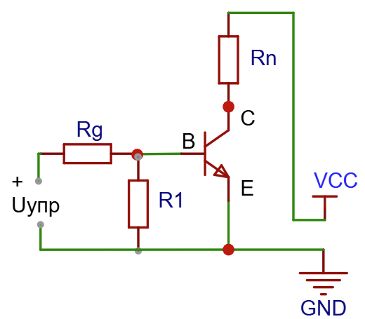
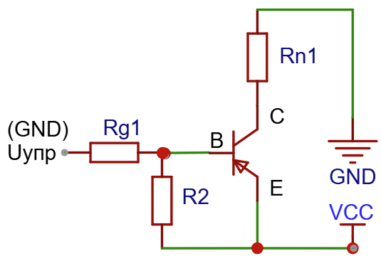
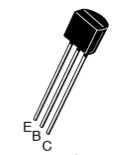
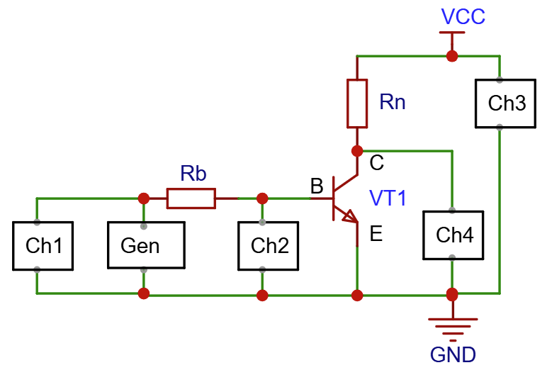

.. _rst_electronics_loadbipolar_loadbipolar:

Управление нагрузкой - Биполярный транзистор
============================================

Цель и задачи
-------------

**Цель:** Изучить свойства биполярного транзистора при управлении нагрузкой в режиме ключа.

#. Изучить переходные процессы при включении и выключении нагрузки.
#. Изучить влияние частоты переключения на работу схемы.
#. Определить потери энергии в цепи управления.
#. Определить потери энергии в цепи коммутации.

Краткие сведения
----------------

Биполярный транзистор рассмотрен в работе :ref:`rst_electronics_bipolar_bipolar`

Для управления нагрузкой используют два основных состояния:

- **Отсечка:** ток базы практически отсутствует, транзистор закрыт.
  Ток нагрузки ограничен токами утечки.

- **Насыщение:** ток базы достаточен для заданного тока нагрузки,
  транзистор открыт, а падение напряжения на переходе коллектор-эмиттер мало.

Между этими состояниями транзистор проходит через **активный режим**,
в котором приближённо выполняется :math:`I_C = h_{FE} I_B`.

Напряжение база-эмиттер :math:`U_{BE}` у открытого (в состоянии насыщения)
кремниевого транзистора обычно составляет примерно 0,7–0,9 В.

Напряжение коллектор–эмиттер в насыщении около 0,1–0,3 В.

Ток базы необходимо ограничивать резистором или специальным драйвером.

Преимущества ключа на биполярном транзисторе:

- небольшие размеры и отсутствие механического износа;
- высокая скорость переключения по сравнению с электромагнитным реле;
- возможность управления от микроконтроллера, благодаря малому управляющему току;
- возможность применения ШИМ;
- простая схема ключа для небольшой нагрузки.

Недостатки ключа на биполярном транзисторе:

- ток управления нужен всё время, пока ключ включён;
- напряжение открытого ключа (переход коллектор-эмиттер 0,1–0,3 В) создаёт потери мощности;
- накопление заряда при насыщении задерживает выключение;
- гальваническая развязка отсутствует;
- невысокие допустимые ток и напряжение;
- для индуктивной нагрузки требуется ограничение выброса напряжения.

Основной схемой подключения биполярного транзистора в режиме ключа является схема **с общим эмиттером**.

Схема подключения транзистора n-p-n структуры в качестве ключа:

|

Схема подключения транзистора p-n-p структуры в качестве ключа:

У ключа на транзисторе p-n-p структуры есть существенное ограничение.
Напряжение питания нагрузки должно совпадать с напряжением питания микроконтроллера (например, 3.3 В или 5 В).

Исследуемый элемент
-------------------

Биполярный транзистор **2N5551**, n-p-n структуры, в корпусе TO-92.

|

Основные параметры по `Документация onsemi на 2N5551`_:

- предельно допустимое напряжение коллектор-эмиттер: 160 В;
- предельно допустимый постоянный ток коллектора: 600 мА;
- :math:`h_{FE} = 80...250`;

Описание опыта
--------------

Используется n-p-n ключ с общим эмиттером в нижнем плече.

- **VT1** — исследуемый транзистор 2N5551.
- **Rn** — нагрузка 100 Ом, мощность не менее 0,5 Вт.
- **Rb** — ограничивающий резистор базы 680 Ом, 0,125 Вт или больше.
- **Gen** — генератор прямоугольных импульсов 0...5 В без отрицательного уровня.
- **VCC** — стабилизированные 5 В.

Сопротивление :math:`R_{BE}` в схеме не используется.
Его роль выполняет осциллограф.

Расчёт и ожидаемые результаты
-----------------------------

Расчёт тока базы и нагрузки
~~~~~~~~~~~~~~~~~~~~~~~~~~~

Исходные значения:

- :math:`U_{VCC} = 5` В
- :math:`R_n = 100` Ом
- :math:`U_{CE} = 0{,}2` В.
- :math:`R_{BE} = 10 КОм`
- :math:`U_{BE} = 0{,}8` В.
- :math:`\beta = I_C/I_B = 10` - Коэффициент передачи тока
  (для уверенного насыщения обычно берут ток базы примерно в 10 раз меньше тока коллектора)

Сначала рассчитаем ток коллектора:

.. math::

   I_C = \frac{5-0{,}2}{100} = 0{,}048\ \text{А} = 48\ \text{мА}.

Далее, рассчитаем ток базы:

.. math::

   I_{B} = \frac{48}{10} = 4{,}8\ \text{мА}

Теперь можно рассчитать сопротивление базы:

.. math::

   R_{B} = \frac{U_{VCC}-U_{BE}}
                    {I_{B}+U_{BE}/R_{BE}}
              = \frac{5-0{,}8}{0{,}0048+0{,}8/10000}
              \approx 861\ \text{Ом}.

Выбираем ближайшее значение сопротивления :math:`R_{BE} = 680 Ом`

Ожидаемые переходные процессы
~~~~~~~~~~~~~~~~~~~~~~~~~~~~~

При низком уровне Gen база находится около GND, транзистор закрыт.
Напряжение коллектор-эмиттер близко к 5 В, ток и напряжение на Rn близки к нулю.

После появления высокого уровня на базе :math:`U_{CE}` уменьшается,
а ток нагрузки увеличивается. В насыщении на нагрузке ожидается примерно 4,8 В.
На переходе одновременно существуют ток и напряжение, что создаёт потери.

При возвращении Gen к нулю ток коллектора падает, а :math:`U_{CE}` повышается к напряжению питания.

С ростом частоты переходные интервалы занимают большую долю периода.

Лабораторная работа
-------------------

Выводы и открытые вопросы
-------------------------

Из принципа работы и предварительного расчёта следуют выводы:

#. Биполярный транзистор позволяет управлять нагрузкой без механических контактов,
   но требует тока базы в течение всего времени включения.
#. Включённый ключ имеет остаточное напряжение, поэтому потери в силовой цепи
   определяются произведением :math:`U_{CE} I_C`, а не только условным сопротивлением.
#. Для маломощной нагрузки потери управления могут превышать потери
   в цепи коллектор-эмиттер. В предложенном примере это примерно 30,9 и 9,6 мВт
   при постоянно включённом ключе.
#. Увеличение тока базы помогает получить насыщение, но требует большей
   мощности управления и может замедлять выключение.
#. Практический диапазон частот зависит от транзистора, схемы управления,
   нагрузки и допустимых потерь. Он требует экспериментальной проверки.

После измерений необходимо ответить на вопросы:

- При каком токе базы достигается достаточно малое :math:`U_{CE}`?
- На какой частоте задержка выключения заметно меняет заполнение тока нагрузки?
- Как изменяются энергия одного переключения и средние потери с частотой?
- Какой RB даёт приемлемое сочетание мощности управления и потерь ключа?
- Достаточно ли прямого управления от выбранного микроконтроллера?
- Как результаты сопоставляются с электромагнитным реле при одинаковой нагрузке?

Ссылки
------

#. `Google`_

.. _Google: https://www.Google.com

2. :ref:`rst_electronics_bipolar_bipolar` — предыдущая работа с 2N5551.
#. :ref:`rst_electronics_load_load` — общая постановка исследования.
#. :ref:`rst_electronics_loademrelay_loademrelay` — управление нагрузкой через реле.
#. `Документация onsemi на 2N5551`_

.. _Документация onsemi на 2N5551: https://www.onsemi.com/pdf/datasheet/2n5551t-d.pdf
