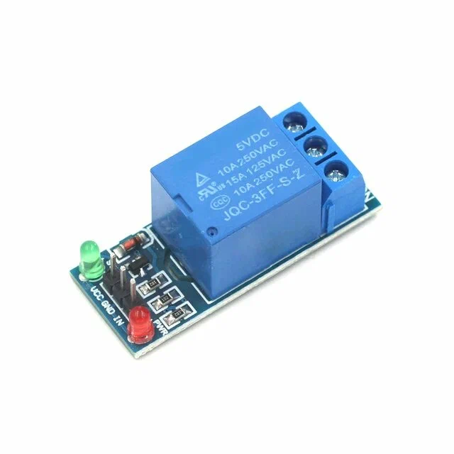
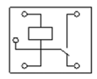
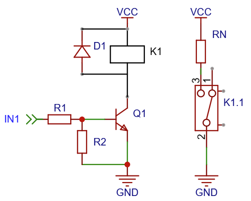
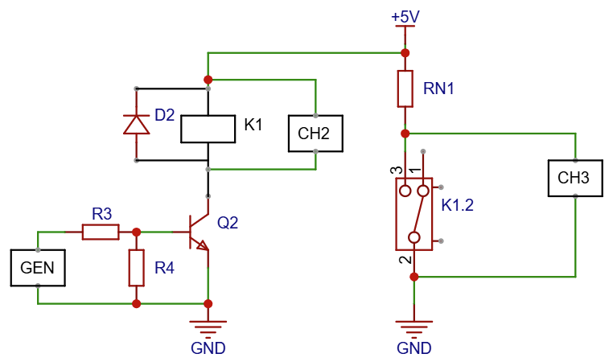
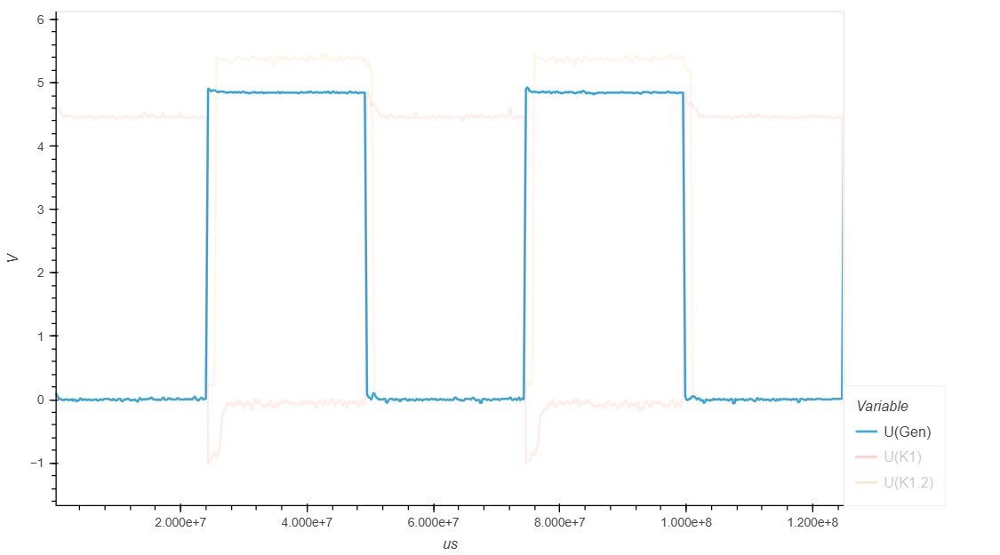
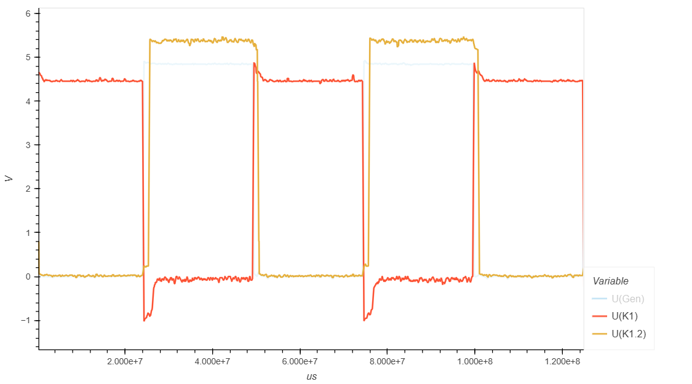
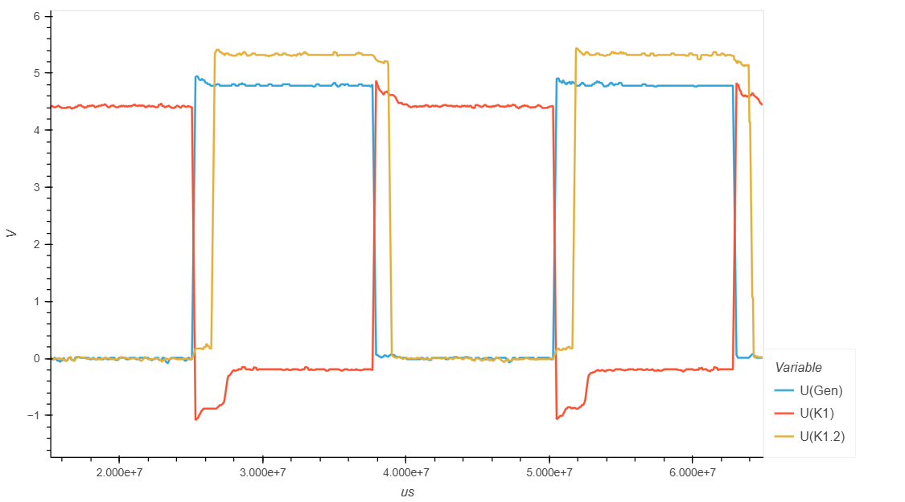
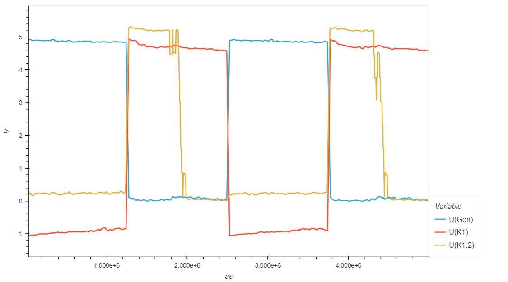
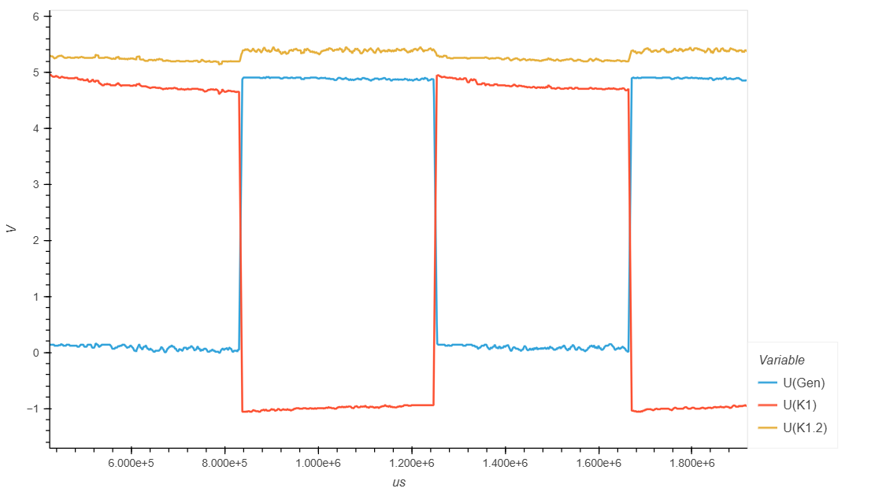

.. _rst_electronics_loademrelay_loademrelay:

Управление нагрузкой - ЭМ Реле
==============================

Цель и задачи
-------------

**Цель:** Изучить свойства Электромагнитного реле:

#. Изучить переходные процессы при включении и выключении нагрузки.
#. Изучить влияние частоты переключения на работу схемы.

Краткие сведения
----------------

**Электромагнитное реле** — это электрический переключатель.
При подаче напряжения на катушку возникает магнитное поле,
которое притягивает якорь и переключает контакты.
После отключения питания пружина возвращает контакты в исходное положение.

Управление катушкой реле может выполняться напрямую от управляющего источника питания
или через транзисторный ключ. При использовании микроконтроллера в качестве источника
управляющего сигнала подключение выполняется только через транзисторный ключ,
поскольку ток микроконтроллера недостаточен для срабатывания реле.
Также самоиндукция катушки может вывести микроконтроллер из строя.

Преимущества электромагнитного реле:

- гальваническая развязка управляющей и силовой цепей;
- возможность управлять большой нагрузкой малым током;
- переключение нескольких цепей одновременно;
- работа как с постоянным, так и с переменным током;
- низкое сопротивление замкнутых контактов.

Недостатки электромагнитного реле:

- механический износ и ограниченный ресурс контактов;
- низкая скорость переключения;
- шум и вибрация при работе;
- сравнительно большие размеры;
- возникновение помех при переключении;
- высокое энергопотребление катушки.

Исследуемый компонент
---------------------

Релейный модуль в сборе на плате с управлением биполярным транзистором
p-n-p типа и электромеханическим реле Tongling 5VDC JQC-3FF-S-Z.

   Релейный модуль с реле 5VDC JQC-3FF-S-Z

- Напряжение питания модуля (VCC): 5 В (DC)
- Управляющее напряжение модуля (IN): GND (срабатывает при подаче низкого потенциала)
- Управляющее напряжение (напряжение катушки): 5 В (DC)
- Сопротивление обмотки: 69 Ом
- Коммутируемый ток: 10A (250V AC) / 10A (30V DC) / 15A (125V AC)
- Максимальное коммутируемое напряжение: 250 В (AC) / 30 В (DC)

В данном модуле используется биполярный транзистор p-n-p типа 2TY.
Соответственно, релейный модуль управляется низким потенциалом.
Т.е., для срабатывания реле на вход (IN) нужно подать низкий потенциал (GND).

Схема расположения контактов на реле приведена ниже.

   Схема расположения контактов реле

Управляющий ток реле составляет порядка 72 мА (:math:`5 В / 69 Ом`).
Для лабораторных генераторов и для микроконтроллеров это большая нагрузка.
Также, самоиндукция катушки может негативно сказаться на результатах измерений.

Поэтому нельзя подключать микроконтроллер или генератора напрямую к реле.

Принципиальная схема подключения реле через транзисторный ключ показана на рисунке ниже.
Здесь приведена схема с транзисторным ключом на биполярном транзисторе n-p-n типа.

   Схема подключения реле через транзисторный ключ

- **R1** - Ограничивает ток базы Q1, защищая транзистор. 330 Ом. 0,125 Вт
- **R2** - Удерживает Q1 выключенным, когда IN1 находится в высокоомном состоянии. 10 кОм. 0,125 Вт
- **Q1** - NPN-транзистор, работающий в режиме ключа.
- **K1** - Катушка реле, которое переключает контакты K1.1.
- **D1** - Защитный диод. При выключении Q1 даёт току катушки путь
  для затухания и ограничивает выброс напряжения на транзисторе.

Схема и оборудование
--------------------

Схема подключения
~~~~~~~~~~~~~~~~~

Схема подключения осциллографов и генератора для проведения измерений приведена на рисунке ниже.
Здесь приведена схема с транзисторным ключом на биполярном транзисторе n-p-n типа.
В эксперименте используется транзистор p-n-p типа.

   Схема подключения реле к измерительному оборудованию

Напряжение источника питания 5В.

- **RN1** - Нагрузка. 100 Ом. 0,5 Вт
- **U(GEN)** - 0В...+5В (импульсы) подаются от генератора GEN

Лабораторная работа
-------------------

Частота переключения 5 Гц
~~~~~~~~~~~~~~~~~~~~~~~~~

С генератора (GEN) подаются прямоугольные импульсы.

- Частота: 5 Гц
- Амплитуда: 0...5В

   Сигнал генератора GEN

**Исходное состояние**

В исходном состоянии на базу транзистора Q2 подается высокий потенциал.
Переход "Коллектор-Эмиттер" закрыт.
Через обмотку реле К1 не протекает ток и на ней нет падения напряжения,
что мы и наблюдаем на графике U(K1) с осциллографа CH2.
Контакты К1.2 разомкнуты. Осциллограф CH3 будет показывать падение напряжения U(K1.2),
равное падению напряжения источника питания.

**Момент включения реле**

При подаче низкого уровня сигнала на вход (IN) Релейного модуля c генератора GEN,
транзисторный ключ на биполярном транзисторе p-n-p типа открывается
и через обмотку реле К1 начинает протекать ток.

Т.к. ток в обмотке не может увеличиться мгновенно, то он будет постепенно нарастать,
до тех пор, пока не достигнет максимального для данного сопротивления обмотки значения.

Основная часть приложенного напряжения падает на обмотке реле,
что мы и наблюдаем на графике U(K1).

До достижения тока срабатывания, якорь притягивается и контакт К1.2 замыкается.
Срабатывание контактов реле К1.2 происходит с задержкой.
В цепи нагрузки RN1 протекает ток.
Падения напряжения на контактах нет, что можно наблюдать на графике U(K1.2).

**Момент выключения реле**

При подаче управляющего импульса на вход IN Релейного модуля (на базу транзисторного ключа Q1),
переход “Коллектор-Эмиттер” закроется и сопротивление резко возрастет.

Поскольку напряжение на обмотке реле не может мгновенно исчезнуть,
на обмотке возникнет напряжение самоиндукции, обратное напряжению источника питания.
Это напряжение разрядится через диод D2.
Осциллограф CH2 покажет всплеск противоположного напряжения U(K1),
а затем спад падения напряжения до нуля.

Когда индуктивность катушки станет недостаточной, чтобы удерживать якорь, ключ К1.1 разомкнется.
Ток в цепи нагрузки пропадет. На сопротивлении RN1 пропадет падение напряжения.
Осциллограф CH3 покажет скачкообразное увеличение напряжения U(K1.2) до напряжения источника питания.

   Падение напряжения на обмотке реле (K1) и на контактах реле (K1.2)

Частота переключения 10 Гц
~~~~~~~~~~~~~~~~~~~~~~~~~~

С генератора (GEN) подаются прямоугольные импульсы.

- Частота: 10 Гц
- Амплитуда: 0...5В

С увеличением частоты переключения, задержка переключения становится более заметной.
Но контакты реле все еще включаются при подаче управляющего сигнала
и выключаются при пропадании управляющего сигнала.

   Сигнал генератора (GEN), падение напряжения на реле (K1) и на контактах реле (K1.2)

Частота переключения 100 Гц
~~~~~~~~~~~~~~~~~~~~~~~~~~~

С генератора (GEN) подаются прямоугольные импульсы.

- Частота: 100 Гц
- Амплитуда: 0...5В

На частоте 100 Гц катушка индуктивности не успевает разрядиться за время управляющего импульса
и контакты остаются замкнуты на протяжении всего импульса и размыкаются только в самом конце импульса.
И затем замыкаются на половине интервала отсутствия управляющего сигнала.

Т.е. происходит, фактически, обратное тому, что необходимо.
Во время управляющего импульса контакты разомкнуты и замыкаются только при пропадании управляющего импульса.

   Сигнал генератора (GEN), падение напряжения на реле (K1) и на контактах реле (K1.2)

Частота переключения 300 Гц
~~~~~~~~~~~~~~~~~~~~~~~~~~~

С генератора (GEN) подаются прямоугольные импульсы.

- Частота: 300 Гц
- Амплитуда: 0...5В

При частоте управляющих импульсов 300 Гц контакты вообще не замыкаются.

   Сигнал генератора (GEN), падение напряжения на реле (K1) и на контактах реле (K1.2)

Выводы и открытые вопросы
-------------------------

При использовании релейных модулей нужно обращать внимание на уровень управляющего сигнала.
Например, в рассмотренном примере, релейный модуль включается
при подаче низкого уровня (GND), а не высокого.

Из основных преимуществ электромагнитных реле можно отметить практически нулевые потери
в цепи нагрузки на контактах реле, т.к. контакты представляют собой замкнутый проводник.
При помощи электромагнитных реле можно коммутировать любое напряжение, как постоянное, так и переменное.
Коммутируемая цепь может быть полностью независима от цепи управления.

Из основных минусов можно отметить низкую скорость срабатывания.
В рассмотренном примере, на частоте 100 Гц реле становится практически непригодным.
Это делает невозможным использование электромагнитных реле для ШИМ.

Ссылки
------

#. `Google`_

.. _Google: https://www.Google.com

#. `ElectronicsClub, Relay | The principle of operation of the relay in the examples`_
#. `EasyEDA`_
#. `ElectronicsClub, Inductors from A to Z How They Really Work`_

.. _ElectronicsClub, Inductors from A to Z How They Really Work: https://www.youtube.com/watch?v=ajx0VZlEEc0
.. _EasyEDA: https://easyeda.com/
.. _ElectronicsClub, Relay | The principle of operation of the relay in the examples: https://www.youtube.com/watch?v=PqnSDNCUon8
