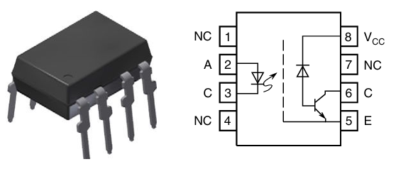
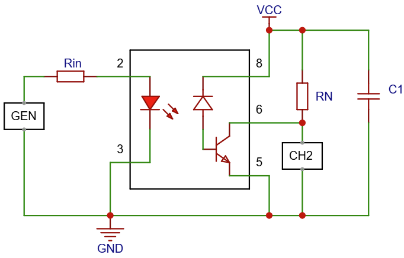
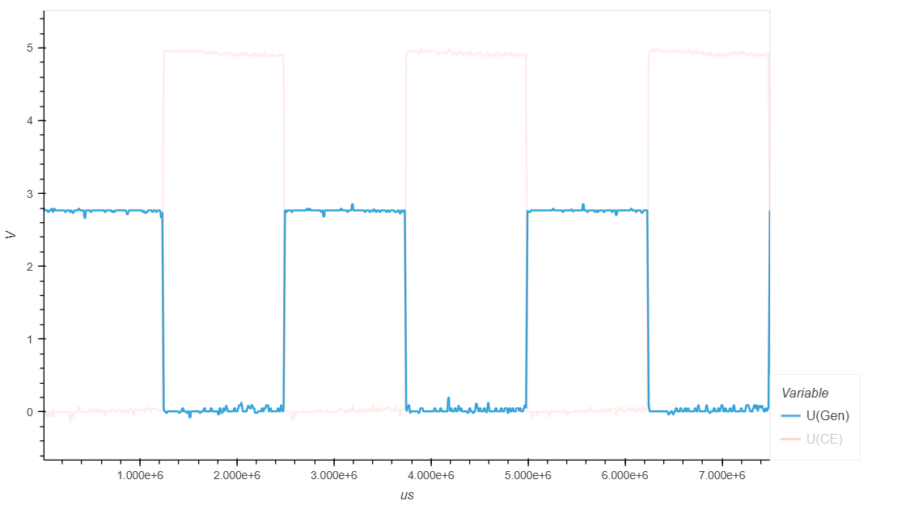
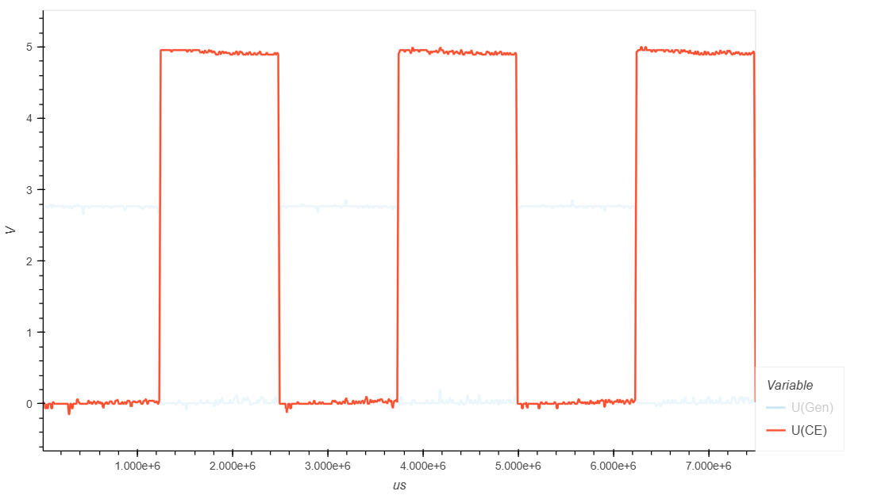
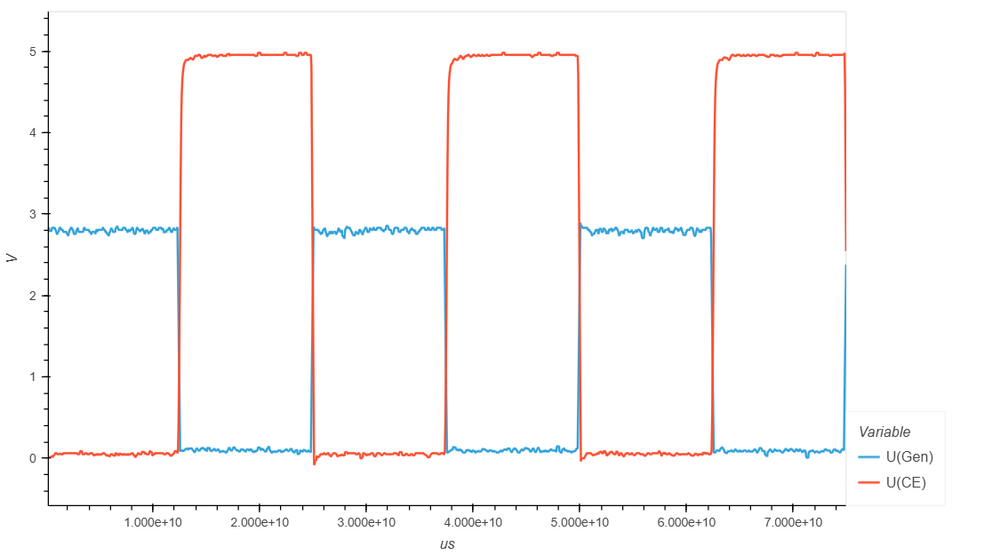
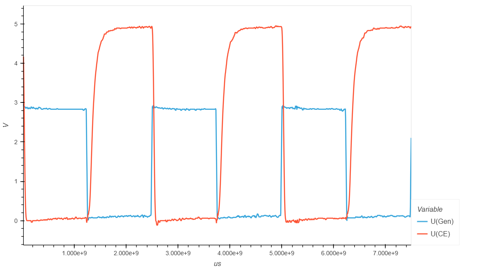
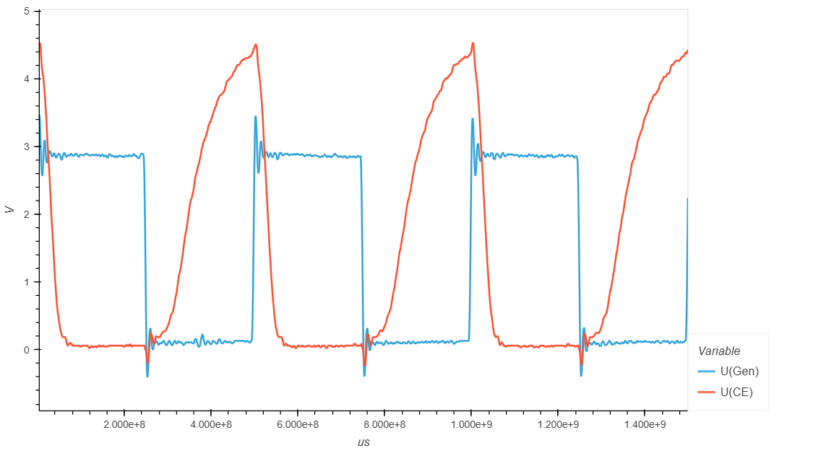
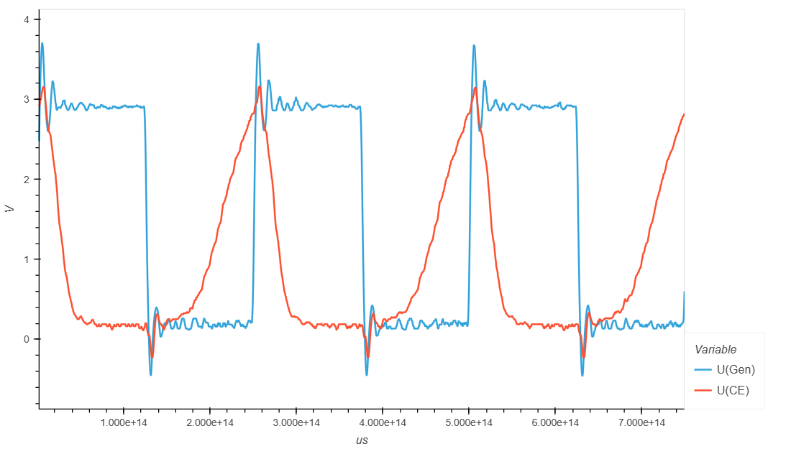

.. _rst_electronics_loadoptocoupler_loadoptocoupler:

Управление нагрузкой - Оптопара
===============================

Цель и задачи
-------------

**Цель:** Изучить свойства оптопары при управлении маломощной нагрузкой.

#. Изучить переходные процессы при включении и выключении нагрузки.
#. Изучить влияние частоты переключения на работу схемы.
#. Оценить ток управления, потери мощности и ограничения выходного каскада.

Краткие сведения
----------------

**Оптопара (оптрон)** передаёт сигнал светом между электрически разделёнными
цепями. На входе установлен светодиод. Входной сигнал включает светодиод.
Ток входного светодиода создаёт излучение, которое воспринимает
фотоприёмник, который управляет транзисторным ключом.

Преимущества:

- гальваническая развязка входа и выхода;
- отсутствие механического износа, шума и дребезга контактов;
- возможность передачи импульсов и ШИМ.

Недостатки:

- необходимость непрерывного тока светодиода во время включения;
- ограниченные ток и напряжение выхода;
- задержки переключения и влияние ёмкости нагрузки.

Исследуемый элемент
-------------------

**SFH6345 Vishay**, одноканальная оптопара в корпусе DIP-8.
Внутри находятся ИК-светодиод, фотодиод и быстродействующий транзистор
n-p-n типа с открытым коллектором.
Вывод базы наружу не выведен.

На входной светодиод (выводы 2, 3) подается сигнал.
Когда входной светодиод включён, транзисторный ключ открыт (выводы 6, 5 замкнуты).
Когда светодиод выключен, транзисторный ключ закрыт (выводы 6, 5 разомкнуты).

Для данного типа оптопары необходимо внешнее питание.

   Оптопара SFH6345

Значения ниже взяты из `Документация Vishay на SFH6345`_,
редакция 2.5 от 04.09.2025, страницы 2–4.

.. list-table:: Основные параметры
   :widths: 55 45
   :header-rows: 1

   * - Параметр
     - Значение и условия
   * - Падение напряжения на светодиоде при 16 мА
     - 1,33 В (типовое); 1,9 В (максимальное)
   * - Рекомендуемый ток входа (светодиода)
     - 2…20 мА
   * - Предельное обратное напряжение светодиода
     - 3 В
   * - Рекомендуемые напряжения питания (VCC)
     - 1,8…25 В
   * - Рекомендуемые напряжения выхода (:math:`U_{CE}`)
     - 0…20 В
   * - Рекомендуемые ток выхода (:math:`I_{CE}`)
     - 0…6 мА
   * - Коэффициент передачи тока открытого ключа CTR
     - 15 % (минимум); 30 % (типовое)

Для входного светодиода оптопары SFH6345 нужно ограничивать ток, а не задавать напряжение.
При прямом включении падение напряжения на нём 1,33...1,9 В при токе 16 мА.
Рекомендуемый прямой ток — 2…20 мА.

Например, от источника 3,5 В светодиод можно включить через резистор:

.. math::

   R = \frac{U_{\text{ист}} - U_F}{I_F}
     = \frac{3{,}5 - 1{,}33}{0{,}016}
     \approx 136\ \text{Ом}.

В схеме выбран резистор 130 Ом — получится около 16,7 мА
при типовом падении напряжения.

Предельно допустимый ток нагрузки :math:`I_{CE}=8\ \text{мА}`.
При этом нужный выходной ток ещё должен обеспечиваться входным током и коэффициентом передачи CTR.

У SFH6345 CTR при определённых условиях составляет 19 %.
При входном токе 16 мА это соответствует:

.. math::

    I_{CE} = 0{,}19 · 16 = 3{,}04\ \text{мА}.

Выходной ток меньше управляющего.
SFH6345 предназначена прежде всего для быстрой передачи сигнала с гальванической развязкой.
Для управления более мощной нагрузкой после неё ставят отдельный транзистор или драйвер с MOSFET.

Для исследуемой оптопары используют следующие варианты схем подключения:

#. **Открытый коллектор с резистором к плюсу питания.** Эмиттер соединяют
   с общим проводом выходной стороны. При свечении входного светодиода
   напряжение коллектора уменьшается. Резистор может служить исследуемой нагрузкой.
#. **Передача логического сигнала.** Коллектор с подтяжкой подключают ко входу
   логической схемы; напряжение подтяжки и ток согласуют с обоими устройствами.
#. **Управление внешним силовым ключом.** Оптопара передаёт сигнал на транзистор
   или драйвер MOSFET, а ток силовой нагрузки проходит через внешний ключ.
   Для быстрого заряда и разряда затвора нужен подходящий драйвер.

Входной светодиод во всех вариантах подключают через ограничитель тока.

Для SFH6345 требуется дополнительное питание (вывод VCC) приёмной стороны.
Но есть оптопары и без дополнительного питания. Например, Galaxy PC817 Series.

Описание опыта
--------------

Ниже предложена схема измерений. Исследуется непосредственно
выход SFH6345, без дополнительного силового транзистора.

   Схема подключения Оптопары SFH6345 к измерительному оборудованию

Состав схемы:

- **Rin** — 130 Ом, не менее 0,125 Вт, ограничивает ток светодиода.
- **RN** — 2,2 кОм, не менее 0,125 Вт, одновременно нагрузка и подтяжка выхода.
- **C1** — керамический конденсатор 100 нФ между выводами 8 и 5, рядом с корпусом.
- **GEN** — прямоугольный сигнал 0…3,5 В, заполнение 50 %.
  Уровни указаны для фактического напряжения на нагруженном выходе генератора.
- **VCC** — стабилизированные 5 В приёмной стороны.
- **GND** — общий провод.

В данном опыте используется общий провод, поэтому гальваническая развязка стенда отсутствует.

Последовательный резистор в цепи VCC не требуется.

**Конденсатор C1** — развязывающий конденсатор по питанию выходного каскада SFH6345.
Он помогает сохранять стабильное напряжение между VCC (вывод 8) и GND (вывод 5).
При переключениях потребляемый ток быстро меняется.
Провода питания имеют индуктивность, поэтому источник не может мгновенно компенсировать эти изменения.
Конденсатор рядом с микросхемой отдаёт небольшой запас энергии и уменьшает кратковременные просадки и помехи питания.
Это снижает вероятность ложных переключений и искажения выходных импульсов.
Он подключается параллельно питанию и постоянный ток нагрузки через него не проходит.

**RN** - ограничивает ток коллектора выходного транзистора и одновременно
подтягивает выход к плюсу питания. Его выбирают по току, который оптопара
может обеспечить при заданном токе входного светодиода.
Для предварительной оценки используем минимальный :math:`CTR = 15\,\%`,
указанный в документации для температуры 0…70 °C при
:math:`I_F = 16` мА, :math:`U_O = 0{,}5` В и VCC = 4,5 В:

.. math::

   I_{O,\min} = I_F \frac{CTR_{\min}}{100\,\%}
              = 16\cdot0{,}15
              = 2{,}4\ \text{мА}.

При питании нагрузки 5 В и принятом низком уровне выхода 0,5 В
расчётная нижняя граница сопротивления равна:

.. math::

   R_N \geq \frac{U_{\text{пит}} - U_O}{I_{O,\min}}
       = \frac{5 - 0{,}5}{0{,}0024}
       = 1875\ \text{Ом}.

Выбираем стандартный номинал **RN = 2,2 кОм**, выше расчётной границы.
При выходном напряжении 0,5 В ток нагрузки составит:

.. math::

   I_N = \frac{5 - 0{,}5}{2200}
       \approx 2{,}05\ \text{мА}.

Даже при нулевом падении на выходном транзисторе ток ограничен
значением :math:`5/2200 \approx 2{,}27` мА при номинальных параметрах.

Лабораторная работа
-------------------

Частота переключения 100 Гц
~~~~~~~~~~~~~~~~~~~~~~~~~~~

С генератора (GEN) подаются прямоугольные импульсы.

- Частота: 100 Гц
- Амплитуда: 0...3.5 В

**Исходное состояние**
С генератора подается низкий потенциал.
Светодиод выключен, выходной транзистор закрыт.
К участку :math:`U_{CE}` приложено все напряжение питания.

**Включение нагрузки**
С генератора подается высокий потенциал.
Светодиод загорается, выходной транзистор открывается.
Падение напряжения :math:`U_{CE}` становится близко к нулю.
Через :math:`R_{N}` начинает течь ток.

   Сигнал генератора Gen

   Падение напряжения на переходе коллектор-эмиттер

Частота переключения 10 КГц
~~~~~~~~~~~~~~~~~~~~~~~~~~~

С генератора (GEN) подаются прямоугольные импульсы.

- Частота: 10 КГц
- Амплитуда: 0...3.5 В

   Сигналы генератора и падения напряжения на переходе коллектор-эмиттер

Частота переключения 100 КГц
~~~~~~~~~~~~~~~~~~~~~~~~~~~~

С генератора (GEN) подаются прямоугольные импульсы.

- Частота: 100 КГц
- Амплитуда: 0...3.5 В

На частоте 100 КГц задержка закрытия выходного транзистора становится заметной.

   Сигналы генератора и падения напряжения на переходе коллектор-эмиттер

Частота переключения 500 КГц
~~~~~~~~~~~~~~~~~~~~~~~~~~~~

С генератора (GEN) подаются прямоугольные импульсы.

- Частота: 500 КГц
- Амплитуда: 0...3.5 В

При частоте 500 КГЦ, выходное напряжение :math:`U_{CE}` не достигает напряжения питания 5 В.
Это может быть из-за того, что выходной транзистор уже не успевает полностью закрыться,
или из-за времени заряда выходной ёмкости оптопары.

   Сигналы генератора и падения напряжения на переходе коллектор-эмиттер

Частота переключения 1000 КГц
~~~~~~~~~~~~~~~~~~~~~~~~~~~~~

С генератора (GEN) подаются прямоугольные импульсы.

- Частота: 1000 КГц
- Амплитуда: 0...3.5 В

   Сигналы генератора и падения напряжения на переходе коллектор-эмиттер

Выводы и открытые вопросы
-------------------------

#. Закрытие выходного транзистора происходит медленнее, чем открытие.
#. На частоте 500 КГц выходной транзистор не успевает полностью закрываться.
#. Для мощной нагрузки, например, 100 Ом от 5 В, потребуется внешний силовой ключ.
#. Выходной сигнал :math:`U_{CE}` инвертирован относительно входа.
#. Потребление входной цепи в выбранном режиме превышает мощность нагрузки.

Ссылки
------

#. `Документация Vishay на SFH6345`_
#. `Каталог оптопар Vishay`_
#. `Оптореле с MOSFET, вопросы и ответы Vishay`_
#. `EasyEDA`_

.. _EasyEDA: https://easyeda.com/
.. _Документация Vishay на SFH6345: https://www.vishay.com/docs/83680/sfh6345.pdf
.. _Каталог оптопар Vishay: https://www.vishay.com/en/optocouplers/
.. _Оптореле с MOSFET, вопросы и ответы Vishay: https://www.vishay.com/docs/84399/solidstaterelaysfaqs.pdf
