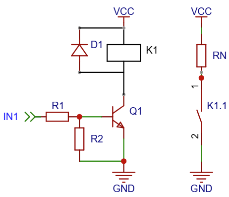
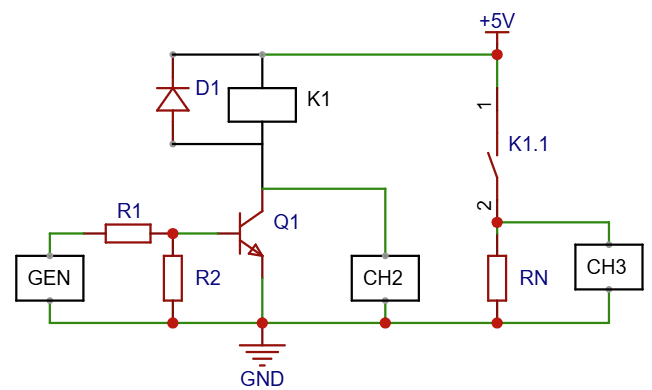

.. _rst_electronics_loadreed_loadreed:

Управление нагрузкой - Геркон
=============================

Цель и задачи
-------------

**Цель:** Изучить свойства герконового реле при управлении нагрузкой.

#. Изучить переходные процессы при включении и выключении нагрузки.
#. Изучить влияние частоты переключения на работу схемы.
#. Определить потери энергии в цепи управления.
#. Определить потери энергии в цепи коммутации.

Краткие сведения
----------------

**Геркон** — герметизированный магнитоуправляемый контакт.
В герметичной колбе находятся упругие ферромагнитные пластины с контактами.
Магнитное поле намагничивает пластины.
У нормально разомкнутого геркона они притягиваются и замыкают цепь.
После ослабления поля упругость пластин возвращает контакт в исходное состояние.

**Герконовое реле** содержит геркон и катушку, создающую управляющее поле.
Катушка может быть шунтирована защитным диодом.
Это разновидность электромеханического реле: ток нагрузки проходит через
механические контакты, но отдельный массивный якорь не требуется.
Катушка и контакты электрически не соединены.

Преимущества:

- гальваническая развязка цепи управления и коммутируемой цепи;
- малое сопротивление замкнутого контакта;
- возможность коммутировать сигналы обеих полярностей;
- защита контактной области от пыли и влаги благодаря герметичной колбе;
- небольшие размеры и обычно более быстрое переключение, чем у силового реле.

Недостатки:

- ограниченные ток, напряжение и мощность коммутации;
- механический износ и дребезг контактов;
- непрерывное потребление энергии катушкой во включённом состоянии;
- чувствительность к внешнему магнитному полю и соседним реле;
- риск сваривания контактов при бросках тока, особенно на ёмкостной нагрузке.

Герконовое реле нельзя считать бесконтактным ключом для высокочастотной ШИМ.

Основные схемы подключения:

#. **Непосредственное питание катушки** от источника постоянного напряжения
   через выключатель. Источник должен обеспечивать ток катушки.
#. **Транзисторный ключ в нижнем плече:** катушка подключена к плюсу питания,
   NPN-транзистор или n-канальный MOSFET замыкает её цепь на общий провод.
   Это основной вариант для управления от генератора или микроконтроллера.
#. **Ключ в верхнем плече** на PNP-транзисторе или p-канальном MOSFET.
   При разных напряжениях питания логики и катушки требуется согласование уровней.

   Схема подключения реле через транзисторный ключ в нижнем плече

Параллельно катушке постоянного тока ставят обратный защитный диод:
катод к плюсу, анод к выводу со стороны ключа. При отключении он даёт току
самоиндукции путь для затухания. Диод защищает транзистор, но замедляет спад тока
и может увеличивать время отпускания. У исполнения со встроенным диодом
необходимо соблюдать полярность питания катушки.

Контакт можно включать последовательно с нагрузкой как со стороны плюса,
так и со стороны обратного провода. Для индуктивной нагрузки нужна отдельная
защита контактов: диод катушки реле не подавляет выброс напряжения самой нагрузки.

Исследуемый элемент
-------------------

**TRR2A05D00-R TTI (Tai-Shing)** — герконовое реле с двумя нормально
разомкнутыми контактными группами (без защитного диода).

В обозначении:

- ``05`` означает катушку 5 В,
- ``D`` перед ``00`` — корпус DIP,
- ``00`` — вариант выводов,
- ``R`` — соответствие RoHS.

Корпус DIP герконового реле TRR2A05D00-R изображен на рисунке:

.. figure:: images/loadreed_01.png
   :width: 25%
   :align: center

   DIP Type

Контакты герконового реле в корпусе DIP изображены на рисунке:

.. figure:: images/loadreed_02.png
   :width: 30%
   :align: center

   TRR2A05D00-R TTI (* with Diode Type Option)

Встроенный диод обозначается дополнительной буквой ``D`` после ``00``.
В маркировке TRR2A05D00-R TTI такой опции нет.

Параметры приведены в источнике `Документация TTI на серию TRR`_ (таблица для TRR-2A).
Пределы указаны для постоянного тока по документации производителя.
Отдельные допустимые значения для AC не указаны.

.. list-table:: Основные параметры TRR2A05D00-R
   :widths: 65 35
   :header-rows: 1

   * - Параметр
     - Значение
   * - Номинальное напряжение катушки
     - 5 В DC
   * - Сопротивление катушки при 20 °C
     - 140 Ом ±10 %
   * - Номинальный ток
     - 35,7 мА
   * - Напряжение срабатывания / отпускания в таблице
     - 3,75 В / 0,8 В
   * - Максимальный ток в момент коммутации
     - 0,5 А DC
   * - Максимальный ток через замкнутые контакты
     - 1 А DC
   * - Максимальное напряжение
     - 100 В DC
   * - Максимальное сопротивление контактов
     - 150 мОм
   * - Время срабатывания / отпускания
     - не более 1 мс / не более 1 мс

- **0,5 А** — ток в момент коммутации: контакты могут замыкать и размыкать цепь с таким током.
- **1 А** — ток через замкнутые контакты (без переключения): такой ток допустимо пропускать после замыкания контактов,
  но перед их размыканием его нужно снизить до допустимого тока коммутации либо отключить другим элементом.

Разница связана с тем, что при переключении возникают искрение и локальный нагрев контактов.

Значения напряжений срабатывания и отпускания не следует считать точными
порогами конкретного экземпляра: их определяют отдельно при плавном изменении питания.

Время отпускания в схеме с внешним диодом необходимо измерить заново.

Описание опыта
--------------

Для управления используется NPN-ключ в нижнем плече:

   Схема подключения реле к измерительному оборудованию

- **K1** — TRR2A05D00-R; используется первая контактная группа K1.1.
  Вторую группу K1.2 оставляют свободной или исследуют отдельно.
  Параллельное соединение групп для увеличения тока в опыте не используется.
- **Q1** — 2N5551 биполярный транзистор n-p-n типа.
- **R1** — 680 Ом, не менее 0,125 Вт.
- **R2** — 10 кОм, не менее 0,125 Вт; удерживает ключ закрытым при отключённом GEN.
- **D1** — внешний защитный диод, например 1N4148.
- **Rn** — резистивная нагрузка 100 Ом, не менее 0,5 Вт.
- **GEN** — прямоугольные импульсы 0...5 В, коэффициент заполнения 50 %.
- Питание катушки и нагрузки — стабилизированные 5 В.

Общий провод генератора соединяют с эмиттером Q1. Катушку не подключают
непосредственно к выходу генератора или GPIO: требуется около 36 мА,
а при отключении возникает ЭДС самоиндукции.

При питании катушки TRR2A05D00-R от 5 В, дополнительный последовательный резистор для ограничения тока не нужен.
Ток ограничивается сопротивлением самой обмотки (140 Ом).

Расчёт и ожидаемые результаты
-----------------------------

Ток катушки и управление транзистором
~~~~~~~~~~~~~~~~~~~~~~~~~~~~~~~~~~~~~~

При прямом питании номинальной катушки:

.. math::

   I_K = \frac{5}{140} \approx 35{,}7\ \text{мА},
   \qquad P_K = \frac{5^2}{140} \approx 179\ \text{мВт}.

Для предложенной схемы примем :math:`U_{CE} = 0{,}2` В.

.. math::

    U_{K} = 5-0{,}2 = 4{,}8 В

Это выше табличных 3,75 В срабатывания.

При :math:`U_{BE} = 0{,}8` В ток выхода генератора и ток базы равны:

.. math::

   I_{GEN} = \frac{5-0{,}8}{680} \approx 6{,}18\ \text{мА},
   \qquad I_B = I_{GEN} - \frac{0{,}8}{10000}
             \approx 6{,}10\ \text{мА}.

Такой ток приемлем для генератора и для микроконтроллера.

Баланс мощности и энергии
~~~~~~~~~~~~~~~~~~~~~~~~~

При постоянно включённом ключе расчётные потери составляют:

- в катушке: :math:`I_K^2 R_K = 35{,}7^2 * 140 \approx 178` мВт;
- на Q1 в цепи коллектора: :math:`U_{CE} I_K = 0{,}2 * 35{,}7 \approx 7{,}14` мВт;
- в цепи питания базы: :math:`U_{GEN} I_{GEN} = 5 * 6{,}18 \approx 30{,}9` мВт.

Итого затраты управления от источника 5 В и выхода генератора:

.. math::

   P_{упр,on} = 178 + 7{,}14 + 30{,}9 \approx 216\ \text{мВт}.

Затраты на питание самого генератора в эти расчеты не входят.

Ожидаемые переходные процессы
~~~~~~~~~~~~~~~~~~~~~~~~~~~~~

При низком уровне GEN транзистор закрыт, катушка обесточена,
контакт разомкнут и :math:`U_n \approx 0`.

При переходе GEN к 5 В транзистор открывается, :math:`U_C` уменьшается,
а ток катушки нарастает. В приближении постоянной индуктивности:

.. math::

   I_K(t) = I_{\infty}\left(1-e^{-t/\tau}\right),
   \qquad \tau \approx \frac{L}{R_K+R_s}.

После достижения достаточного магнитного поля контакт замыкается,
и :math:`U_n` возрастает почти до 5 В. До устойчивого замыкания возможен дребезг.
Модель RL описывает электрическое нарастание тока приближённо;
время механического движения контактов в неё не входит.

При переходе GEN к нулю транзистор закрывается. Ток катушки сохраняет
прежнее направление и замыкается через D1. Напряжение коллектора
кратковременно становится примерно на прямое падение D1 выше питания,
а напряжение катушки меняет знак. По мере спада тока контакт отпускает,
после чего :math:`U_n` возвращается к нулю.

С увеличением частоты длительности включения и выключения уменьшаются.
Катушка может не успеть набрать ток срабатывания или сбросить его до отпускания;
возможны пропуски переключений и удержание контакта замкнутым.
При заполнении 50 % время каждой фазы равно :math:`1/(2f)`:
100 мс при 5 Гц, 5 мс при 100 Гц, 1 мс при 500 Гц и 0,5 мс при 1 кГц.
Сопоставление с временем переключения показывает, где ожидать ограничения,
но не задаёт гарантированную рабочую частоту реле, особенно с внешним диодом.

Лабораторная работа
-------------------

Частота переключения 5 Гц
~~~~~~~~~~~~~~~~~~~~~~~~~

Повышение частоты
~~~~~~~~~~~~~~~~~~

Повторить измерения на 10, 50 и 100 Гц. При устойчивой работе кратковременно
проверить 200 и 500 Гц; 1 кГц использовать как проверку ограничения скорости,
если предыдущие режимы допускают осмысленное продолжение опыта.
Это исследовательские режимы, а не заявленные изготовителем рабочие частоты.

Выводы и открытые вопросы
-------------------------

Из принципа работы и предварительного расчёта следуют выводы:

#. Герконовое реле обеспечивает гальваническую развязку и малые потери
   в замкнутом контакте, но сохраняет механические ограничения скорости и ресурса.
#. Для выбранной нагрузки 5 В / 100 Ом потери на контакте оцениваются
   долями милливатта; затраты управления существенно больше.
#. Катушка TRR2A05D00-R потребляет примерно 178 мВт при прямом питании 5 В.
   Малые размеры реле не означают возможность управления от любого GPIO.
#. Защитный диод влияет на динамику отпускания, поэтому частотные свойства
   следует сравнивать вместе со схемой подавления самоиндукции.

Ссылки
------

#. `Документация TTI на серию TRR`_
#. `EasyEDA`_

.. _EasyEDA: https://easyeda.com/
.. _Документация TTI на серию TRR: https://cdn.promelec.ru/upload/items/2021/04/05/datasheets/TRR.pdf
