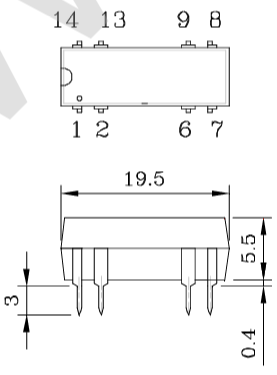
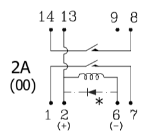

.. _rst_electronics_loadreed_loadreed:

Управление нагрузкой - Геркон
=============================

Цель и задачи
-------------

**Цель:** Изучить свойства герконового реле при управлении нагрузкой.

#. Изучить переходные процессы при включении и выключении нагрузки.
#. Изучить влияние частоты переключения на работу схемы.
#. Определить потери энергии в цепи управления.
#. Определить потери энергии в цепи коммутации.

Краткие сведения
----------------

**Геркон** — герметизированный магнитоуправляемый контакт.
В герметичной колбе находятся упругие ферромагнитные пластины с контактами.
Магнитное поле намагничивает пластины.
У нормально разомкнутого геркона они притягиваются и замыкают цепь.
После ослабления поля упругость пластин возвращает контакт в исходное состояние.

**Герконовое реле** содержит геркон и катушку, создающую управляющее поле.
Катушка может быть шунтирована защитным диодом.
Это разновидность электромеханического реле: ток нагрузки проходит через
механические контакты, но отдельный массивный якорь не требуется.
Катушка и контакты электрически не соединены.

Преимущества:

- гальваническая развязка цепи управления и коммутируемой цепи;
- малое сопротивление замкнутого контакта;
- возможность коммутировать сигналы обеих полярностей;
- защита контактной области от пыли и влаги благодаря герметичной колбе;
- небольшие размеры и обычно более быстрое переключение, чем у силового реле.

Недостатки:

- ограниченные ток, напряжение и мощность коммутации;
- механический износ и дребезг контактов;
- непрерывное потребление энергии катушкой во включённом состоянии;
- чувствительность к внешнему магнитному полю и соседним реле;
- риск сваривания контактов при бросках тока, особенно на ёмкостной нагрузке.

Герконовое реле нельзя считать бесконтактным ключом для высокочастотной ШИМ.

Основные схемы подключения:

#. **Непосредственное питание катушки** от источника постоянного напряжения
   через выключатель. Источник должен обеспечивать ток катушки.
#. **Транзисторный ключ в нижнем плече:** катушка подключена к плюсу питания,
   NPN-транзистор или n-канальный MOSFET замыкает её цепь на общий провод.
   Это основной вариант для управления от генератора или микроконтроллера.
#. **Ключ в верхнем плече** на PNP-транзисторе или p-канальном MOSFET.
   При разных напряжениях питания логики и катушки требуется согласование уровней.

Параллельно катушке постоянного тока ставят обратный защитный диод:
катод к плюсу, анод к выводу со стороны ключа. При отключении он даёт току
самоиндукции путь для затухания. Диод защищает транзистор, но замедляет спад тока
и может увеличивать время отпускания. У исполнения со встроенным диодом
необходимо соблюдать полярность питания катушки.

Контакт можно включать последовательно с нагрузкой как со стороны плюса,
так и со стороны обратного провода. Для индуктивной нагрузки нужна отдельная
защита контактов: диод катушки реле не подавляет выброс напряжения самой нагрузки.

Исследуемый элемент
-------------------

**TRR2A05D00-R TTI (Tai-Shing)** — герконовое реле с двумя нормально
разомкнутыми контактными группами (2 Form A, DPST-NO).
В обозначении:

- ``05`` означает катушку 5 В,
- ``D`` перед ``00`` — корпус DIP,
- ``00`` — вариант выводов,
- ``R`` — соответствие RoHS.

Корпус DIP герконового реле TRR2A05D00-R изображен на следующем рисунке:

   DIP Type

Контакты герконового реле в корпусе DIP изображены на следующем рисунке:

   TRR2A05D00-R TTI (* with Diode Type Option)

Встроенный диод обозначается дополнительной буквой ``D`` после ``00``.
В маркировке TRR2A05D00-R TTI такой опции нет.

Параметры приведены в источнике `Документация TTI на серию TRR`_
(таблицы для TRR-2A):

.. list-table:: Основные параметры TRR2A05D00-R
   :widths: 65 35
   :header-rows: 1

   * - Параметр
     - Значение
   * - Номинальное напряжение катушки
     - 5 В DC
   * - Сопротивление катушки при 20 °C
     - 140 Ом ±10 %
   * - Номинальный ток / мощность катушки
     - 35,7 мА / 179 мВт
   * - Напряжение срабатывания / отпускания в таблице
     - 3,75 В / 0,8 В
   * - Максимальный ток коммутации / ток переноса
     - 0,5 А DC / 1 А DC
   * - Максимальное напряжение / мощность коммутации
     - 100 В DC / 10 ВА
   * - Максимальное сопротивление контактов
     - 150 мОм
   * - Время срабатывания / отпускания, включая дребезг
     - не более 1 мс / не более 1 мс

Предельные ток, напряжение и мощность должны соблюдаться одновременно.
Ток переноса относится к уже замкнутым контактам и не разрешает переключать 1 А.
Значения напряжений срабатывания и отпускания не следует считать точными
порогами конкретного экземпляра: их определяют отдельно при плавном изменении питания.
Время отпускания в схеме с внешним диодом необходимо измерить заново.

Перед монтажом следует сверить расположение выводов с рисунком
``WIRING DIAGRAM — DIP Type — 2A (00)`` в документации и проверить мультиметром
катушку и обе контактные группы. Нумерация DIP использует позиции
14-выводного корпуса с пропущенными выводами; считать выводы подряд нельзя.
Данные катушки TRR-1A (500 Ом, 10 мА) к TRR-2A не относятся.

Описание опыта
--------------

Ниже предложен вариант стенда для сравнения с работами
:ref:`rst_electronics_loademrelay_loademrelay` и
:ref:`rst_electronics_loadbipolar_loadbipolar`.
Это исходные условия планируемого опыта, а не описание уже выполненных измерений.

Схема и оборудование
~~~~~~~~~~~~~~~~~~~~

Для управления используется NPN-ключ в нижнем плече:

.. code-block:: text

   Цепь управления:
   +5 V ---- Rs ---- катушка K1 ---- коллектор VT1
   GND --------------------------- эмиттер VT1
   GEN ---- Rb ------------------- база VT1
   база VT1 ---- Rbe ---- GND

   D1: катод к +5 V, анод к коллектору VT1.
   Диод включён параллельно всей цепочке Rs + катушка K1.

   Цепь нагрузки:
   +5 V нагрузки ---- K1.1 ---- Rn ---- GND нагрузки

- **K1** — TRR2A05D00-R; используется первая контактная группа K1.1.
  Вторую группу K1.2 оставляют свободной или исследуют отдельно.
  Параллельное соединение групп для увеличения тока в опыте не используется.
- **VT1** — 2N5551; назначение его выводов проверяют по документации.
- **Rb** — 680 Ом, не менее 0,125 Вт.
- **Rbe** — 10 кОм, не менее 0,125 Вт; удерживает ключ закрытым при отключённом GEN.
- **D1** — внешний защитный диод, например 1N4148.
- **Rs** — измерительный резистор 1 Ом, 1 %, не менее 0,125 Вт.
  При измерениях только напряжений его можно заменить перемычкой.
- **Rn** — резистивная нагрузка 100 Ом, не менее 0,5 Вт.
- **GEN** — прямоугольные импульсы 0...5 В, коэффициент заполнения 50 %.
- Питание катушки и нагрузки — стабилизированные 5 В.

Общий провод генератора соединяют с эмиттером VT1. Катушку не подключают
непосредственно к выходу генератора или GPIO: требуется около 36 мА,
а при отключении возникает ЭДС самоиндукции. Уровни GEN проверяют
на подключённом стенде, учитывая настройку нагрузки выхода генератора.

Точки измерения
~~~~~~~~~~~~~~~

- :math:`U_{GEN}` — напряжение на выходе генератора относительно GND.
- :math:`U_C` — напряжение коллектора VT1 относительно GND.
- :math:`U_n` — напряжение на Rn; оно показывает состояние контакта.
- :math:`U_{Rs}` — падение напряжения на измерительном резисторе;
  ток катушки :math:`I_K = U_{Rs}/R_s`.

Если питание нагрузки равно 5 В, напряжение на контакте
:math:`U_{K1.1} = 5 - U_n`. Напряжение непосредственно на катушке
равно напряжению её верхнего вывода минус :math:`U_C`.

Падение на Rs измеряют дифференциальным пробником либо разностью двух каналов,
измеряющих оба его вывода относительно GND. Земляные зажимы обычного
осциллографа подключают только к общему проводу, поскольку они обычно
электрически соединены между собой. На Rs ожидаются десятки милливольт,
поэтому существенны погрешность вычитания и смещение каналов.

При недостаточном числе каналов измерения выполняют несколькими проходами
с неизменными настройками генератора. Для обычных щупов в этом стенде
используют общий GND управления и нагрузки; тем самым измерительные соединения
объединяют цепи, хотя само реле обеспечивает развязку. Для исследования
развязанных цепей нужны соответствующие изолированные средства измерения.

Расчёт и ожидаемые результаты
-----------------------------

Ток катушки и управление транзистором
~~~~~~~~~~~~~~~~~~~~~~~~~~~~~~~~~~~~~~

При прямом питании номинальной катушки:

.. math::

   I_K = \frac{5}{140} \approx 35{,}7\ \text{мА},
   \qquad P_K = \frac{5^2}{140} \approx 179\ \text{мВт}.

Из-за допуска сопротивления ±10 % ток при 5 В составляет примерно
32,5...39,7 мА без учёта нагрева. Катушка этого реле не является нагрузкой 10 мА.

Для предложенной схемы примем :math:`U_{CE(sat)} = 0{,}2` В:

.. math::

   I_K = \frac{5-0{,}2}{140+1} \approx 34{,}0\ \text{мА},
   \qquad U_K = 140 I_K \approx 4{,}77\ \text{В}.

Это выше табличных 3,75 В срабатывания. Оценка не учитывает разброс
падения на транзисторе, температуры и напряжения источника.
Надёжное включение проверяют на реальном экземпляре.

При :math:`U_{BE} = 0{,}8` В ток выхода генератора и ток базы равны:

.. math::

   I_{GEN} = \frac{5-0{,}8}{680} \approx 6{,}18\ \text{мА},
   \qquad I_B = I_{GEN} - \frac{0{,}8}{10000}
             \approx 6{,}10\ \text{мА}.

Вынужденный коэффициент :math:`I_C/I_B \approx 5{,}6` даёт запас тока базы
для насыщения. Эти значения — расчёт при принятых напряжениях переходов;
фактическое :math:`U_{CE(sat)}` определяют измерением.

Ток нагрузки и потери на контактах
~~~~~~~~~~~~~~~~~~~~~~~~~~~~~~~~~~

Для оценки примем :math:`R_{конт} = 0{,}15` Ом:

.. math::

   I_n = \frac{5}{100+0{,}15} \approx 49{,}9\ \text{мА},

   U_{конт} = I_n R_{конт} \approx 7{,}5\ \text{мВ},
   \qquad P_{конт} = I_n^2 R_{конт} \approx 0{,}374\ \text{мВт},

   P_n = I_n^2 R_n \approx 0{,}249\ \text{Вт}.

Нагрузка находится существенно ниже пределов коммутации реле.
Для измерения сопротивления контактов на уровне долей ома желательно
четырёхпроводное подключение: сопротивление проводов и макетной платы
может быть сопоставимо с сопротивлением контакта.

Баланс мощности и энергии
~~~~~~~~~~~~~~~~~~~~~~~~~

При постоянно включённом ключе расчётные потери составляют:

- в катушке: :math:`I_K^2 R_K \approx 162` мВт;
- на VT1 в цепи коллектора: :math:`U_{CE(sat)} I_K \approx 6{,}8` мВт;
- на Rs: :math:`I_K^2 R_s \approx 1{,}16` мВт;
- в цепи питания базы: :math:`U_{GEN} I_{GEN} \approx 30{,}9` мВт.

Итого затраты управления от источника 5 В и выхода генератора:

.. math::

   P_{упр,on} = 5 I_K + U_{GEN} I_{GEN}
                \approx 201\ \text{мВт}.

Затраты на питание самого генератора в этот баланс не входят.
При медленном переключении и заполнении 50 % средняя мощность управления
приблизительно равна 100 мВт, а средние потери на контакте — 0,187 мВт.
При 5 Гц энергия управления за период ориентировочно составляет
:math:`0{,}100/5 \approx 0{,}020` Дж.
Эти оценки предполагают, что переходные интервалы малы по сравнению с периодом.

Для обработки измерений за целое число периодов используют:

.. math::

   E_{упр} = \int \left(U_{пит} I_{пит} + U_{GEN} I_{GEN}\right) dt,
   \qquad E_{конт} = \int U_{K1.1} I_n\,dt,
   \qquad \overline{P} = \frac{E}{\Delta t}.

Здесь :math:`I_{пит}` — ток именно ветви управления, без тока нагрузки.
После закрытия VT1 ток катушки циркулирует через D1 и Rs, но от источника
питания этой ветви ток уже не поступает. Поэтому нельзя подставлять ток
катушки вместо тока источника на всём периоде.
Тепловые потери обмотки оценивают отдельно как :math:`\int I_K^2 R_K\,dt`.

Катушка запасает энергию :math:`E_L = L I_K^2/2`. После отключения
она рассеивается преимущественно в обмотке, диоде и Rs.
Индуктивность данного экземпляра не задана, поэтому численное значение
запасённой энергии и постоянной времени заранее не назначается.

Ожидаемые переходные процессы
~~~~~~~~~~~~~~~~~~~~~~~~~~~~~

При низком уровне GEN транзистор закрыт, катушка обесточена,
контакт разомкнут и :math:`U_n \approx 0`.

При переходе GEN к 5 В транзистор открывается, :math:`U_C` уменьшается,
а ток катушки нарастает. В приближении постоянной индуктивности:

.. math::

   I_K(t) = I_{\infty}\left(1-e^{-t/\tau}\right),
   \qquad \tau \approx \frac{L}{R_K+R_s}.

После достижения достаточного магнитного поля контакт замыкается,
и :math:`U_n` возрастает почти до 5 В. До устойчивого замыкания возможен дребезг.
Модель RL описывает электрическое нарастание тока приближённо;
время механического движения контактов в неё не входит.

При переходе GEN к нулю транзистор закрывается. Ток катушки сохраняет
прежнее направление и замыкается через D1. Напряжение коллектора
кратковременно становится примерно на прямое падение D1 выше питания,
а напряжение катушки меняет знак. По мере спада тока контакт отпускает,
после чего :math:`U_n` возвращается к нулю.

С увеличением частоты длительности включения и выключения уменьшаются.
Катушка может не успеть набрать ток срабатывания или сбросить его до отпускания;
возможны пропуски переключений и удержание контакта замкнутым.
При заполнении 50 % время каждой фазы равно :math:`1/(2f)`:
100 мс при 5 Гц, 5 мс при 100 Гц, 1 мс при 500 Гц и 0,5 мс при 1 кГц.
Сопоставление с временем переключения показывает, где ожидать ограничения,
но не задаёт гарантированную рабочую частоту реле, особенно с внешним диодом.

Лабораторная работа
-------------------

Подготовка
~~~~~~~~~~

#. При отключённом питании проверить выводы, сопротивление катушки,
   разомкнутое состояние обеих групп и полярность D1.
#. Собрать стенд, установить ограничение тока источника с запасом
   относительно суммарного расчётного тока катушки и нагрузки около 90 мА.
#. Подать постоянные уровни GEN: 0 В и 5 В. Измерить напряжение катушки,
   ток, напряжение коллектора и состояние контакта.
#. Убедиться, что транзистор насыщен, а амплитуда GEN соответствует заданной.
   Записать фактические сопротивления и напряжения для уточнения расчётов.

Частота переключения 5 Гц
~~~~~~~~~~~~~~~~~~~~~~~~~

Установить импульсы 0...5 В с заполнением 50 %. Снять общий вид периода
и отдельно увеличить участки замыкания и размыкания контакта.

Определить:

- время от фронта GEN до первого замыкания и до устойчивого замыкания;
- длительность дребезга при замыкании;
- время от спада GEN до первого размыкания и до устойчивого размыкания;
- длительность дребезга при размыкании;
- установившиеся токи катушки и нагрузки, напряжение контакта;
- выброс на коллекторе и длительность затухания тока через D1.

Для сопоставимости задержки отсчитывают от пересечения GEN уровня 50 %,
а состояние контакта определяют по пересечению :math:`U_n` уровня
половины его установившегося значения. Отдельно фиксируют первое переключение
и момент, после которого повторных пересечений из-за дребезга уже нет.

Повышение частоты
~~~~~~~~~~~~~~~~~~

Повторить измерения на 10, 50 и 100 Гц. При устойчивой работе кратковременно
проверить 200 и 500 Гц; 1 кГц использовать как проверку ограничения скорости,
если предыдущие режимы допускают осмысленное продолжение опыта.
Это исследовательские режимы, а не заявленные изготовителем рабочие частоты.

Для каждой частоты записать длительности фаз, минимальный и максимальный
ток катушки, фактическую длительность замкнутого состояния, задержки
и наличие пропусков. Если контакт перестал переключаться каждый период,
зафиксировать это состояние и прекратить дальнейшее повышение частоты.
При необходимости уменьшить шаг частоты около обнаруженной границы.

Не следует длительно работать на предельной частоте: каждый цикл расходует
ресурс контактов. Не отключать защитный диод ради увеличения скорости
без предварительного расчёта другого ограничителя перенапряжения.

Обработка результатов
~~~~~~~~~~~~~~~~~~~~~

#. Сравнить измеренный установившийся ток катушки с расчётом по её сопротивлению.
#. По току и падению напряжения оценить сопротивление контакта с учётом
   погрешности и сопротивления соединений.
#. Рассчитать средние мощности и энергии за период в управлении,
   нагрузке и контакте. Для малых контактных потерь указать погрешность:
   разность двух напряжений порядка 5 В плохо разрешает единицы милливольт.
#. Сравнить коэффициент заполнения GEN и фактическое время замкнутого контакта.
#. Определить диапазон частот устойчивого переключения при заданных
   питании, нагрузке, заполнении и защитном диоде.

Осциллограммы и графики добавляются после выполнения измерений.
Расчётные ожидания выше не являются экспериментальными результатами.

Выводы и открытые вопросы
-------------------------

Из принципа работы и предварительного расчёта следуют выводы:

#. Герконовое реле обеспечивает гальваническую развязку и малые потери
   в замкнутом контакте, но сохраняет механические ограничения скорости и ресурса.
#. Для выбранной нагрузки 5 В / 100 Ом потери на контакте оцениваются
   долями милливатта; затраты управления существенно больше.
#. Катушка TRR2A05D00-R потребляет примерно 0,18 Вт при прямом питании 5 В.
   Малые размеры реле не означают возможность управления от любого GPIO.
#. Защитный диод влияет на динамику отпускания, поэтому частотные свойства
   следует сравнивать вместе со схемой подавления самоиндукции.

После опыта необходимо ответить на вопросы:

- Каковы реальные задержки, дребезг и разброс времени переключения?
- При какой частоте появляются пропуски или удержание контакта?
- Насколько результаты меняются после прогрева катушки?
- Насколько синхронно переключаются две группы при одинаковой нагрузке?
- Как соотносятся энергия управления и потери контакта с результатами
  для электромагнитного реле и биполярного ключа?

Ссылки
------

#. `Документация TTI на серию TRR`_
#. `EasyEDA`_

.. _EasyEDA: https://easyeda.com/
.. _Документация TTI на серию TRR: https://cdn.promelec.ru/upload/items/2021/04/05/datasheets/TRR.pdf
