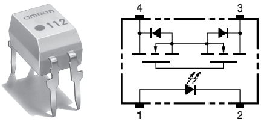
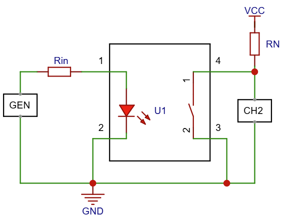
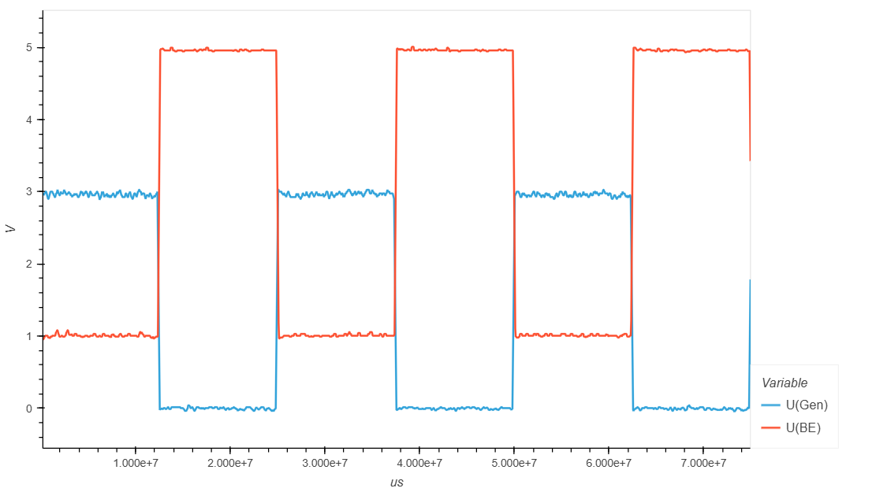
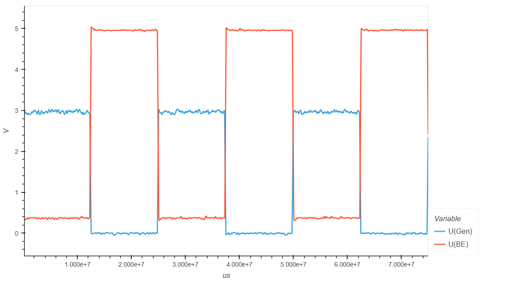
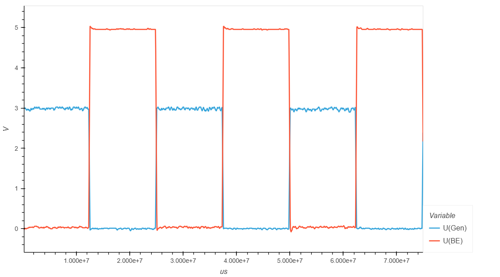
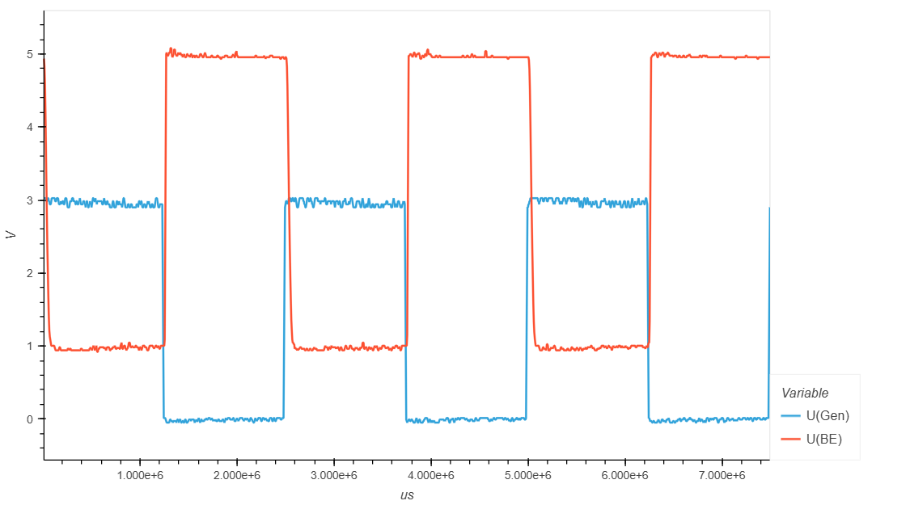
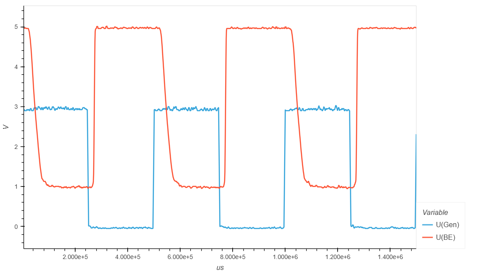
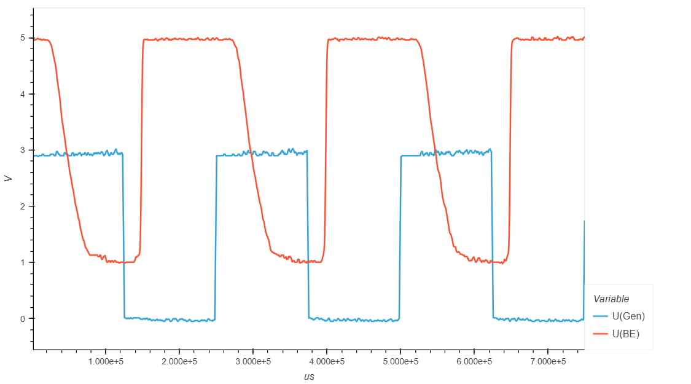
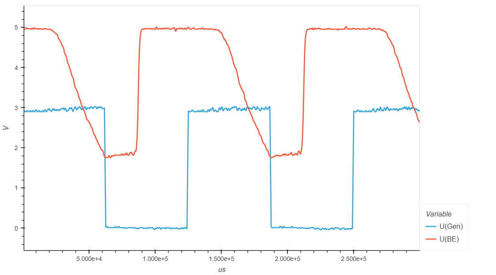

.. _rst_electronics_loadsolidstate_loadsolidstate:

Управление нагрузкой - Твердотельное реле
=========================================

Цель и задачи
-------------

**Цель:** Изучить свойства твердотельного MOSFET-реле при управлении нагрузкой.

#. Изучить переходные процессы при включении и выключении нагрузки.
#. Изучить влияние частоты переключения на работу схемы.
#. Оценить ток управления, сопротивление открытого выхода и потери мощности.

Краткие сведения
----------------

**Твердотельное реле (SSR)** коммутирует нагрузку полупроводниковым ключом.
В этой работе рассматривается оптически управляемое **MOSFET-реле**.
Входной светодиод освещает фотодиодную матрицу, которая создаёт напряжение
для управления затворами выходных MOSFET. После выключения светодиода
цепь управления разряжает затворы и выход перестаёт проводить.
Отдельный источник питания выходного драйвера не требуется.

Два выходных MOSFET включены встречно-последовательно, с общими истоками.
В выключенном состоянии их встроенные диоды не образуют сквозной цепи
ни для одной полярности напряжения; во включённом состоянии ток может
протекать в обоих направлениях. Поэтому такой выход подходит для DC и AC.
Принцип описан в `Обзор твердотельных реле OMRON`_.

Преимущества:

- гальваническая развязка входа и выхода;
- отсутствие механического износа, дребезга и звука переключения;
- небольшой ток управления;
- компактный корпус;
- относительно высокая скорость переключения;
- коммутация постоянного и переменного тока одним выходом.

Недостатки:

- сопротивление открытого выхода вызывает падение напряжения и нагрев;
- выключенный выход имеет ток утечки и паразитную ёмкость;
- ограничены ток, напряжение и допустимые перегрузки;
- ток светодиода нужен всё время включения;
- задержки заряда и разряда затворов ограничивают частоту переключения.

Твердотельные реле бывают также с симисторным или тиристорным выходом.
Их свойства нельзя переносить на MOSFET-реле: в частности, G3VM-351A
не ожидает перехода тока через ноль для выключения.
Отличия выходных каскадов приведены в `Основы MOSFET-реле OMRON`_.

Основные схемы подключения:

#. **Нижнее плечо:** плюс питания — нагрузка — выход реле — общий провод.
   Удобно измерять напряжение реле относительно общего провода.
#. **Верхнее плечо:** плюс питания — выход реле — нагрузка — общий провод.
   Удобно измерять напряжение нагрузки относительно общего провода.
#. **Последовательный ключ в цепи переменного сигнала:** выход включают
   в разрыв цепи, учитывая амплитуду напряжения, пиковый ток и ёмкость выхода.

Во всех случаях входной светодиод подключают с ограничением тока.
Полярность входа обязательна; полярность выходных выводов можно менять.
У четырёхвыводного G3VM-351A нет доступа к средней точке MOSFET,
поэтому схемы объединения выводов для увеличения тока у других корпусов
здесь неприменимы.

Исследуемый элемент
-------------------

**OMRON G3VM-351A**, одноканальное MOSFET-реле в корпусе DIP-4,
с нормально разомкнутым выходом (1a, SPST-NO).

   Твердотельное реле OMRON G3VM-351A

Назначение выводов:

- **1** — анод входного светодиода;
- **2** — катод входного светодиода;
- **3, 4** — двунаправленный выход.

Нумерацию сверяют с меткой вывода 1 и рисунком корпуса в документации.

Значения взяты из `Документация OMRON на G3VM-351A/D`_,
каталог K146-E1-02, страницы 1–2. Электрические характеристики указаны
при температуре 25 °C, если не оговорено иное.

.. list-table:: Параметры G3VM-351A
   :widths: 50 50
   :header-rows: 1

   * - Параметр
     - Значение и условия
   * - Падение напряжения на светодиоде при 10 мА
     - 1,15 В / 1,3 В (тип. / макс.)
   * - Рекомендуемый ток светодиода
     - 5…25 мА; типовой 7,5 мА
   * - Предельное обратное напряжение светодиода
     - 5 В
   * - Рекомендуемое напряжение нагрузки
     - Не более 280 В (DC/AC)
   * - Рекомендуемый ток нагрузки
     - Не более 100 мА
   * - Предельный непрерывный ток выхода
     - 120 мА
   * - Сопротивление открытого выхода
     - Тип. 35 Ом

Описание опыта
--------------

Предлагается опыт с резистивной нагрузкой при питании 5 В.

   Схема подключения OMRON G3VM-351A к измерительному оборудованию

Состав стенда:

- **Rin** — 300 Ом, не менее 0,125 Вт;
- **RN** — 100 Ом, не менее 0,5 Вт;
- **GEN** — прямоугольный сигнал 0…3,5 В, заполнение 50 %;
- **VCC** — стабилизированный источник 5 В;

В этом варианте общий провод генератора, источника и осциллографа объединён.
Сам элемент обеспечивает развязку, но **в стенде гальваническая развязка
входа и выхода отсутствует**.

Расчёты
-------

Входная цепь
~~~~~~~~~~~~

Для выбора Rin примем напряжение высокого уровня генератора :math:`U_{GEN}=3{,}5\ \text{В}` ,
типовое падение на светодиоде :math:`U_F=1{,}15\ \text{В}`  и рекомендуемый типовой ток
светодиода :math:`I_F=7{,}5\ \text{мА}`:

.. math::

   R_{in} = \frac{U_{GEN} - U_F}{I_F}
          = \frac{3{,}5 - 1{,}15}{0{,}0075}
          \approx 313\ \text{Ом}.

Выбираем ближайший стандартный номинал **Rin = 300 Ом**.

Пересчитаем ожидаемый ток светодиода для выбранного сопротивления:

.. math::

   I_F = \frac{U_{GEN} - U_F}{R_{in}}
       = \frac{3{,}5 - 1{,}15}{300}
       \approx 0{,}00783\ \text{А} = 7{,}83\ \text{мА}.

При постоянно включённом входе:

.. math::

   P_{\text{упр}} = U_{GEN} I_F = 3{,}5 \cdot 0{,}00783 \approx 27{,}4\ \text{мВт}.

.. math::

   P_{Rin} = I_F^2 R_{in} = 0{,}00783^2 \cdot 300 \approx 18{,}4\ \text{мВт}.

Выходная цепь
~~~~~~~~~~~~~~

В установившемся включённом состоянии используем модель
последовательно соединённых RN и сопротивления выхода.
Примем питание 5 В, нагрузку :math:`R_{N}=100\ \text{Ом}` и сопротивление выхода :math:`R_{ON}=35\ \text{Ом}`.

Ток нагрузки:

.. math::

   I_N = \frac{U_{VCC}}{R_N + R_{ON}}
       = \frac{5}{100 + 35}
       \approx 0{,}03704\ \text{А} = 37{,}04\ \text{мА}.

Падение напряжения на открытом реле:

.. math::

   U_{ON} = I_N R_{ON}
          = 0{,}03704 \cdot 35
          \approx 1{,}30\ \text{В}.

Напряжение на нагрузке:

.. math::

   U_N = I_N R_N
       = 0{,}03704 \cdot 100
       \approx 3{,}70\ \text{В}.

Мощность, рассеиваемая в реле:

.. math::

   P_{\text{реле}} = I_N^2 R_{ON}
                    = 0{,}03704^2 \cdot 35
                    \approx 0{,}0480\ \text{Вт} = 48{,}0\ \text{мВт}.

Мощность нагрузки:

.. math::

   P_N = I_N^2 R_N
       = 0{,}03704^2 \cdot 100
       \approx 0{,}137\ \text{Вт} = 137\ \text{мВт}.

Для принятого :math:`R_{ON}=35\ \text{Ом}` = 35 Ом в нагрузку
поступает около 74 % мощности выходного источника во включённом состоянии;
остальное рассеивается в реле. Затраты входной цепи учитывают отдельно.

Лабораторная работа
-------------------

Частота переключения 10 Гц
~~~~~~~~~~~~~~~~~~~~~~~~~~

С генератора (GEN) подаются прямоугольные импульсы.

- Частота: 10 Гц
- Амплитуда: 0...3.5 В

В **исходном состоянии** с генератора (GEN) подается низкий потенциал.
Выходная цепь разомкнута.
Падение напряжения между выходными контактами (4, 3) близко к напряжения питания 5 В.

**Включение.**
С генератора (GEN) подается высокий потенциал.
Входной ток заряжает затворы выходных MOSFET.
Сопротивление выхода (контакты 4, 3) снижается до :math:`R_{ON}=35\ \text{Ом}`.
Падение напряжения между выходными контактами (4, 3) снижается.
Ток нагрузки растет.

Важно отметить, что замкнутых выходных контактах (4, 3),
падение напряжения на них, при сопротивлении нагрузки 100 Ом будет порядка 1 В.
Т.е. потери мощности на выходных контактах реле будут порядка 30%.

**Выключение.**
С генератора (GEN) подается низкий потенциал.
Выходное напряжение (контакты 4, 3) возвращается к 5 В, а ток нагрузки уменьшается.
Механического дребезга нет.

   Зависимость входного и выходного сигнала при :math:`R_{N}` 100 Ом

При увеличении сопротивления нагрузки до 270 Ом падение напряжения
на выходных контактах в замкнутом состоянии уменьшается до 0.4 В.

   Зависимость входного и выходного сигнала при :math:`R_{N}` 270 Ом

При сопротивлении нагрузки 1 КОм падение напряжения
на выходных контактах становится практически незаметным.

   Зависимость входного и выходного сигнала при :math:`R_{N}` 1 КОм

Частота переключения 100 Гц
~~~~~~~~~~~~~~~~~~~~~~~~~~~

С генератора (GEN) подаются прямоугольные импульсы.

- Частота: 100 Гц
- Амплитуда: 0...3.5 В

   Зависимость входного и выходного сигнала

Частота переключения 500 Гц
~~~~~~~~~~~~~~~~~~~~~~~~~~~

С генератора (GEN) подаются прямоугольные импульсы.

- Частота: 500 Гц
- Амплитуда: 0...3.5 В

При увеличении частоты до 500 Гц задержки включения и выключения выходной цепи увеличиваются.
Причем задержка на включение больше задержки на выключение.

   Зависимость входного и выходного сигнала

Частота переключения 1 КГц
~~~~~~~~~~~~~~~~~~~~~~~~~~

С генератора (GEN) подаются прямоугольные импульсы.

- Частота: 1 КГц
- Амплитуда: 0...3.5 В

   Зависимость входного и выходного сигнала

Частота переключения 2 КГц
~~~~~~~~~~~~~~~~~~~~~~~~~~

С генератора (GEN) подаются прямоугольные импульсы.

- Частота: 2 КГц
- Амплитуда: 0...3.5 В

На частоте 2 КГц выходная цепь не успевает выключаться.

   Зависимость входного и выходного сигнала

Выводы
------

#. Твердотельное MOSFET-реле позволяет управлять постоянным и переменным напряжением
#. Есть гальваническая развязка входа и выхода за счет использования оптопары.
#. Отсутствует дребезг при переключении, характерный для механических реле.
#. Для низкоомной нагрузки (например, 100 Ом) сопротивление выходных контактов существенно.
#. На частоте 1 КГц задержки переключения занимают половину импульса,
   а при частоте 2 КГц переключение не успевает выполнятся.

Ссылки
------

#. `Документация OMRON на G3VM-351A/D`_
#. `Обзор твердотельных реле OMRON`_
#. `Основы MOSFET-реле OMRON`_
#. `ElectronicsClub, Твердотельное реле | Простыми словами с примерами и расчетом`_
#. `EasyEDA`_

.. _EasyEDA: https://easyeda.com/
.. _ElectronicsClub, Твердотельное реле | Простыми словами с примерами и расчетом: https://www.youtube.com/watch?v=1YAvGxe2YHA
.. _Документация OMRON на G3VM-351A/D: https://omronfs.omron.com/en_US/ecb/products/pdf/en-g3vm_351a_d.pdf
.. _Обзор твердотельных реле OMRON: https://www.ia.omron.com/support/guide/18/overview.html
.. _Основы MOSFET-реле OMRON: https://components.omron.com/sg-en/products/basic-knowledge/mosfet-relays/basics
